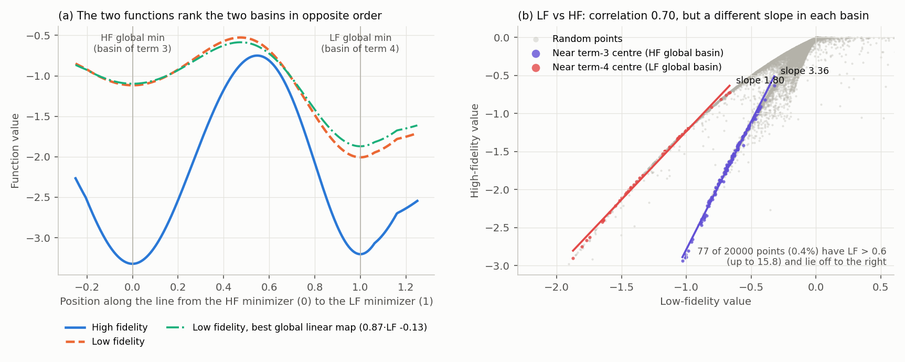
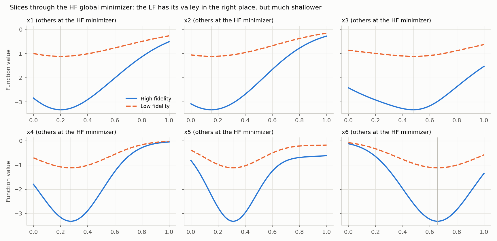
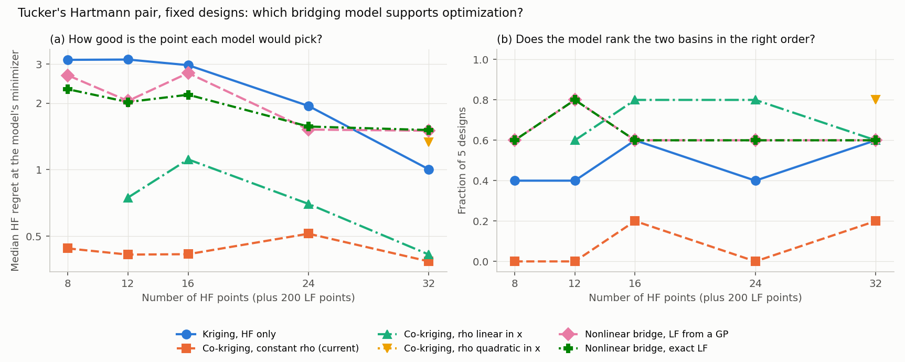
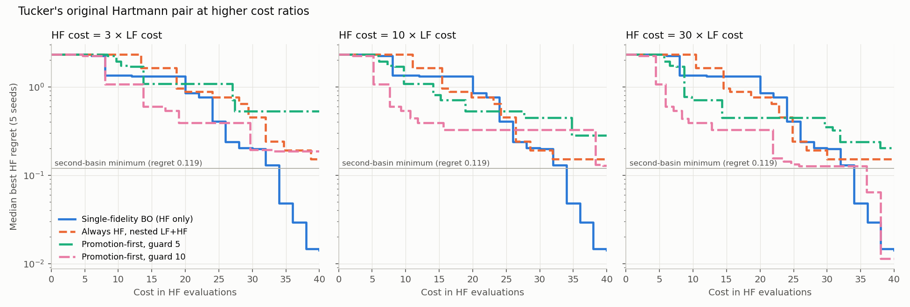
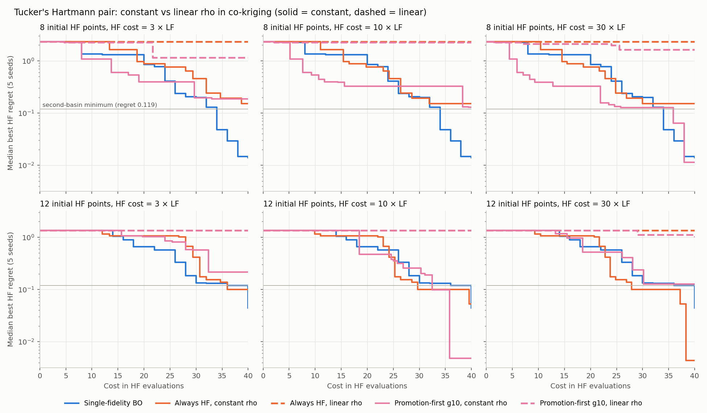
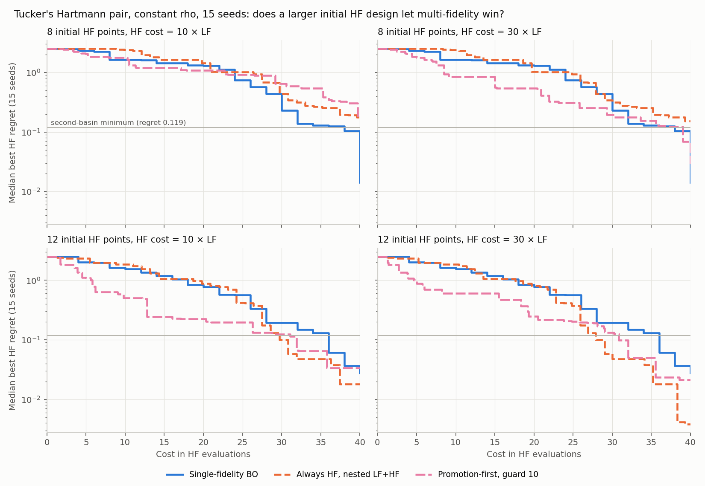
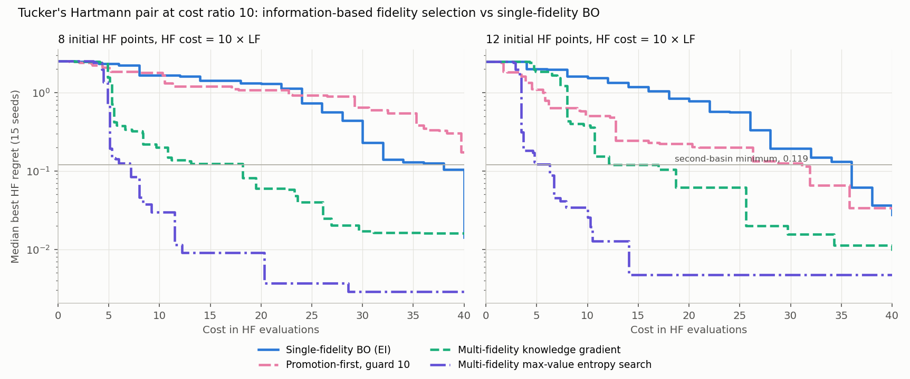
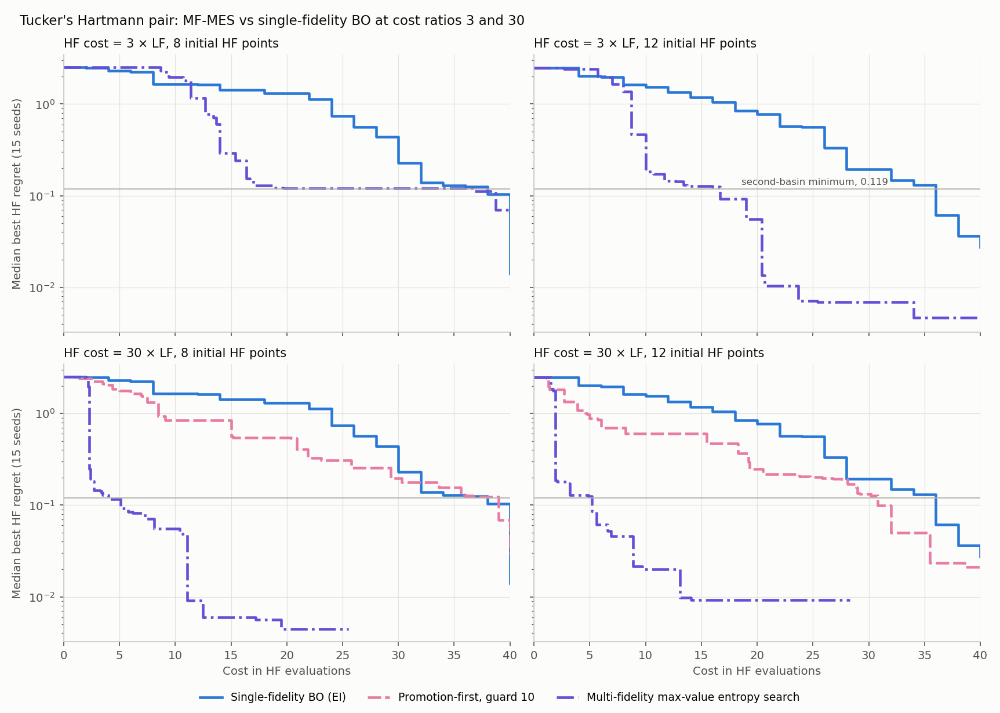

# MF-SEGO `mfsego_cost_power` sensitivity: diagnosis, a promotion-first alternative, and information-based fidelity selection

Branch: `thartland/AdaptiveComputing` `main` @ 773c893 ("6d problem").
Problem: `examples/HPC_onsite2/BO_6d_mf_local.py`, 6D Hartmann, costs LF = 1 and HF = 3, 8 HF + 10 LF initial points.
Environment: SMT 2.13.0, numpy 1.26.4.

## Conclusions (updated 2026-11-10 with MF-MES at HF cost 3 and 30)

### The `mfsego_cost_power` sensitivity

- **It is caused by bugs, not tuning.** The flip between "all LF" and "all HF" comes from two bugs and an under-determined discrepancy model (sections 1 and 2). Fixes A, B and C should be merged whichever policy you keep.
- **Fixing the bugs is not enough.** With 8 HF points in 6D the discrepancy GP collapses, so MF-SEGO's variance-per-cost rule never picks HF on its own (section 3).
- **A promotion-first policy gives a real LF/HF mix with no cost exponent** (section 4): screen new points at LF, then spend HF on the best LF points by EI per cost. Its streak-guard length then becomes the sensitive parameter (sections 8 and 13). Of guards 3, 5 and 10, guard 10 had the best median on 5 seeds, and guard 5 the best worst case at cost 3. The 15-seed runs used guard 10 only.
- **Multi-fidelity max-value entropy search (MF-MES) removes the tuned parameters and works better** (section 16). It chooses location and fidelity by information per unit cost, on the same co-kriging model, with no cost exponent, promotion fraction or guard. It needed none at cost ratios 10 and 30, but at cost ratio 3 it spends most of the budget on LF and stalled on LF in 1 of 30 runs (section 16c).

### The benchmark

- **It is valid and hard.** It is the Park, Haftka & Kim (2016) Hartmann-6 pair, also in `mf2`. Within each deep basin the LF predicts HF almost perfectly, but the scale factor differs between the basins (3.36 against 1.80). A constant-rho co-kriging model therefore ranks the basins in the wrong order and is drawn to the second basin, regret 0.119 (sections 9 and 10).

### Information-based fidelity selection (section 16)

- **MF-MES beats single-fidelity BO on every one of 15 seeds at 10 and 20 HF-equivalents**, with 8 or 12 initial HF points (p < 0.001), and on 13 or 14 of 15 at 30. With 8 initial points its median regret at 10 HF-equivalents is 0.030, against 1.65 for single-fidelity BO and 1.79 for promotion-first. It reaches regret 0.5 after a median of 3.5 to 5 HF-equivalents, against 26 to 28.
- **It still does not win at the full budget.** At 40 HF-equivalents MF-MES is 7-3 and 7-7 against single-fidelity BO (p = 0.5 to 0.6). About 40% of runs of every method, single-fidelity BO included, end in the second basin. MF-MES gets to its final basin much sooner, but does not escape the second basin more often.
- **MF-KG is also better early, but less so, and can stall.** It wins 12 to 14 of 15 seeds at 10 to 30 HF-equivalents with 8 initial points, but is not significant with 12. In one run it chose LF 285 times and HF once.
- **A guard on LF spending does not reliably fix MF-KG**, and averaging over the discrepancy hyperparameters does not fix it at all. On this problem LF really is a cheap, highly correlated proxy across most of the box, so one-step KG at cost ratio 10 keeps rating LF about 12 times better per unit cost. The discrepancy that matters is local, near the optima.
- **At HF cost 30 MF-MES is far ahead early** (section 16c; the jobs hit their 24 h limit with 17 of 30 runs at the full budget, so 30 and 40 are partial). It beats single-fidelity BO on 15 of 15 seeds at 5, 10 and 20 HF-equivalents with either design, and reaches regret 0.5 after a median of about 2 HF-equivalents. Its median regret at 10 HF-equivalents is 0.02 to 0.06, against 1.5 to 1.7 for single-fidelity BO and 0.6 to 0.8 for promotion-first. At 40 it ties (4-2 and 4-3 on the seeds that got there); 12 of 30 runs ended in the second basin.
- **At HF cost 3 (the original setting) MF-MES helps less and is not safe with 8 initial points.** With 12 initial points it wins 12 to 14 of 15 seeds at 10 to 30 HF-equivalents (p < 0.01). With 8 it loses 0-4 at 5, wins 12-3 at 20 (p = 0.02), and is not significant at 10 or 30. It spends about three quarters of its cost on LF. One run chose LF 103 times in a row (34 HF-equivalents) and ended at regret 1.0. At 40 it ties single-fidelity BO with either design.

### When the LF pays off

Section 15 compares each run with single-fidelity BO on HF alone, from the same seed and initial design, at equal cost, over 15 seeds (38 to 52). Cost is in HF-evaluation equivalents and the budget is 40.

- **At HF cost 3 (the original setting), single-fidelity BO wins at the full budget.** It beats every earlier multi-fidelity policy on all 5 seeds (section 8). MF-MES ties it at 40 over 15 seeds, and beats it at 10 to 30 HF-equivalents only with 12 initial points (section 16c).
- **At HF cost 10 or 30, the LF helps early.** Promotion-first beats single-fidelity BO on 10 to 12 of 15 seeds after 10 and 20 HF-equivalents (p = 0.01 to 0.04). This holds at cost 30 with 8 or 12 initial HF points, and at cost 10 with 12. It reaches regret 0.5 after a median of 12 to 21 HF-equivalents, against 26 to 28. At cost 10 with 8 initial points there is no early advantage.
- **It does not help at the full budget.** After 40 HF-equivalents no multi-fidelity policy is significantly better than single-fidelity BO in any configuration. Promotion-first loses more seeds than it wins in every one, and 13 of 15 at cost 10 with 8 initial points.
- **Bottom line:** on this problem multi-fidelity is worth using when the HF budget is small and HF costs at least 10 times LF. With promotion-first the window is about 10 to 20 HF evaluations; with MF-MES at cost 10 or 30 it extends to about 30, with either initial design, and the advantage grows with the cost ratio. At cost 3 MF-MES helps only with 12 initial HF points. With enough budget for single-fidelity BO to converge, single-fidelity BO does as well at every cost ratio tested.
- **A larger initial HF design helps co-kriging.** With 12 instead of 8 initial HF points, always-HF ends better on 14 of 15 seeds at both cost ratios, and promotion-first does at cost 10. Single-fidelity BO does not change significantly. I have not explained this, since the static test in section 10 shows constant rho still ranking the basins wrongly with 12 points.
- **The policy wins when the LF points to the right basin.** With two LFs whose minimum is at the HF minimizer, promotion-first beats single-fidelity BO on all 5 seeds at half budget (section 12; 5 seeds only).

### What did not help

- **Linear-in-x rho** (`rho_regr="linear"`, now reachable through the new `mfk_kwargs` argument of `SMT_GP`). On fixed designs it ranks the basins correctly more often (section 10). Inside BO it extrapolates below the true minimum with large variance at the box corners, so EI sends about half the samples to the bounds. It made almost no progress in any of 60 runs (section 14).
- **Choosing by EI per cost when the streak guard fires** helps on the aligned LFs, but at cost 3 it made guard 5 worse: median 0.35 became 0.53 (section 13).

### A caution on evidence

- **Five seeds were not enough here.** In section 14, a 5-seed median suggested that 12 initial points let multi-fidelity win at the full budget. That configuration had lost on 4 of its 5 seeds, and the result did not survive 15 paired seeds. The 5-seed results in sections 5 to 13 should be read with that in mind.

Suggestions are in section 17.

## 1. Reproduction of the reported behaviour (seed 38, 30 steps, batch 2)

| run | fidelities chosen | final cost | final regret |
|---|---|---|---|
| power 0.5 | HF (nested) 30/30 | 154 | 0.012 |
| power 1.0 | LF 30/30 | 64 | 2.232, no change |
| power 2.0 | LF 30/30 | 64 | 2.232, no change |
| cost-ratio nested driver | HF 30/30 | 154 | 0.012 |

Power 0.5 and the cost-ratio driver give byte-identical trajectories. Promotion fired 0 times in 120 selections.

## 2. Causes

**Bug A: the HF score double-counts the LF variance.** SMT's `MFK.predict_variances_all_levels` already returns the total variance per level when `propagate_uncertainty=True`, which is SMT's default. I checked this numerically: `MSE[:,1] = s_delta + rho^2 * MSE[:,0]` to 3e-17. The extra `np.cumsum` makes the HF score `2 rho^2 s0 + s_delta`. With nested costs normalized to [0.25, 1], HF then wins iff `2 + r > 4^p`, where `r = s_delta / (rho^2 s0)`. At p = 0.5 that is `r > 0`, so HF always wins. In the logs the two scores differ in the 4th significant digit.

**Bug B: the promotion gate is dead.** `expected_improvement` on this branch returns `-log(EI + 1e-30)`, but `get_next_sample` still computes `max(-acq, 0)`, which is `max(log EI, 0)`. That is 0 whenever EI < 1, so `promotion_ei > 0` never passes.

**Bug C: the low-fidelity streak guard is never applied in MF-SEGO.** The call exists only in the commented-out block.

**Model issue: the discrepancy GP collapses.** With 8 HF points in 6D, the discrepancy length scales sit at the lower bound in 5 of 6 dimensions, and its variance is about 1e-4 everywhere. Over 2000 random points r has median 0.05 and 95th percentile 0.31. The corrected rule needs r > 3 at p = 1. Because r hardly varies with x, the decision is a global constant against a threshold, which is why behaviour is a step function in p. rho^2 also jumps between 2.2 and 7.6 between refits.

## 3. Bug fixes alone (seed 38)

| run | fidelity mix | cost | regret |
|---|---|---|---|
| fix A only, power 1.0 | LF 30/30 | 64 | 2.232 |
| fixes A+B+C, power 0.5 | 25 LF, 5 HF | 79 | 2.232 |
| fixes A+B+C, power 1.0 | identical to 0.5 | 79 | 2.232 |
| fixes A+B+C, power 2.0 | 11 LF, 19 HF | 120 | 1.348 |

The sensitivity between 0.5 and 1.0 is gone, but every HF evaluation at those powers was forced by the streak guard. The variance score never chose HF.

## 4. Promotion-first policy

New driver: `adaptive_computing/drivers/hero_mf_promotion.py` (`ActiveLoopDriverHeroMFPromotion`). Each step:

1. Find the new location `x_new` by minimizing HF acquisition, as before, and compute its EI on the pending-aware HF posterior.
2. Compute the HF EI at every completed LF point that has no HF value yet (the promotion pool, i.e. the whole LF history).
3. Promote the best pool point (HF job only, cost 3) when `EI_promote / c_HF >= EI_new / (c_LF + c_HF)`. With costs 1 and 3 this means `EI_promote >= 0.75 EI_new`. The threshold comes from the costs, not from a tuned exponent.
4. Otherwise screen `x_new` at LF (cost 1). If LF at `x_new` is already known (LF posterior variance below 1e-3 of the prior), screening teaches nothing, so evaluate HF at `x_new` instead.
5. After 5 consecutive LF-only selections (the existing `max_low_fidelity_streak`), force an HF evaluation. The first version always promoted the best pool point here. The revised version picks promotion or HF at the new location by EI per cost (section 13).

## 5. Multi-seed comparison at equal adaptive cost (budget 120, seeds 38-42)

"Always HF" picks the HF-EI location and runs nested LF + HF every step, at a cost of 4 per point. That is what the unfixed MF-SEGO does at p = 0.5. Regret is the best observed HF value minus the known minimum. Chart: `regret_vs_cost.png`.

Median regret over 5 seeds:

| policy | cost 40 | cost 80 | cost 120 | mean at 120 | worst seed at 120 |
|---|---|---|---|---|---|
| Always HF | 1.631 | 0.760 | 0.152 | 0.387 | 1.366 |
| Promotion-first | 1.348 | 0.401 | 0.350 | 0.380 | 0.706 |
| Promotion-first, no streak guard | 1.077 | 0.392 | 0.205 | 0.928 | 2.688 |

Per seed at cost 120:

| seed | Always HF | Promotion-first | no guard |
|---|---|---|---|
| 38 | 0.020 | 0.706 | 1.586 |
| 39 | 0.126 | 0.470 | 0.132 |
| 40 | 1.366 | 0.350 | 2.688 |
| 41 | 0.274 | 0.216 | 0.029 |
| 42 | 0.152 | 0.158 | 0.205 |

How each policy spent its budget:

| policy | HF jobs | LF jobs | HF share of cost | EI-driven promotions | guard-forced promotions |
|---|---|---|---|---|---|
| Promotion-first | 17-24 | 50-70 | 42-59% | 6-12 | 2-10 |
| no guard | 2-25 | 51-115 | 5-60% | 1-17 | 0 |

What this shows:

- **The mix is real.** With the guard, every seed spends roughly half its budget on HF, and the EI-per-cost rule itself triggers 6-12 promotions per run. This is not a parameter forcing an extreme.
- **It helps early and protects the worst case.** At cost 80 it beats always-HF on 4 of 5 seeds. At cost 120 its worst seed is 0.71 against 1.37.
- **It plateaus late.** At cost 120 it loses clearly on seeds 38 and 39, so its median is worse. The reason is that the LF and HF rank their two deepest basins in opposite order (sections 9 and 10).
- **The guard is load-bearing.** Without it, seeds 40 and 42 collapse to 2 and 4 HF jobs. The new-location EI stays inflated by the HF model's extrapolation (EI values above the maximum possible improvement), so screening keeps looking better than promoting. This is the original failure mode in milder form.

## 6. Caveats

- Five seeds on one problem in sections 1 to 14. Sections 8 to 13 add a guard sweep, the single-fidelity baseline, higher cost ratios and an aligned LF. Section 15 extends the main comparison to 15 paired seeds, and some 5-seed conclusions changed.
- "Always HF" pays 4 per HF point because it always runs LF too. Section 8 adds plain single-fidelity BO at 3 per point.

## 8. Streak-guard sweep and single-fidelity baseline

Same 5 seeds and budget 120. "Single-fidelity BO" uses the same 8 initial HF points, no LF data, a plain Kriging model, and HF-EI selection at cost 3 per point. Rerunning guard 5 reproduced the first job's results exactly on all 5 seeds, so the runs are deterministic. Chart: `sweep_regret_vs_cost.png`.

| policy | median @40 | median @80 | median @120 | mean @120 | worst @120 | HF share of cost |
|---|---|---|---|---|---|---|
| Single-fidelity BO | 1.314 | 0.237 | **0.014** | **0.051** | **0.120** | 100% |
| Always HF, nested LF+HF | 1.631 | 0.760 | 0.152 | 0.387 | 1.366 | 75% |
| Promotion-first, guard 3 | 2.132 | 1.348 | 0.463 | 0.823 | 2.157 | 50-60% |
| Promotion-first, guard 5 | 1.348 | 0.401 | 0.350 | 0.380 | 0.706 | 42-59% |
| Promotion-first, guard 10 | 1.077 | 0.196 | 0.139 | 0.879 | 2.429 | 22-60% |
| Promotion-first, no guard | 1.077 | 0.392 | 0.205 | 0.928 | 2.688 | 5-60% |

Per seed at cost 120:

| seed | Single-fidelity | Always HF | guard 3 | guard 5 | guard 10 | no guard |
|---|---|---|---|---|---|---|
| 38 | 0.001 | 0.020 | 1.348 | 0.706 | 1.586 | 1.586 |
| 39 | 0.119 | 0.126 | 2.157 | 0.470 | 0.139 | 0.132 |
| 40 | 0.014 | 1.366 | 0.463 | 0.350 | 2.429 | 2.688 |
| 41 | 0.000 | 0.274 | 0.011 | 0.216 | 0.118 | 0.029 |
| 42 | 0.120 | 0.152 | 0.138 | 0.158 | 0.123 | 0.205 |

- **Single-fidelity BO wins on every seed at cost 120**, against every multi-fidelity policy. At cost 80 the multi-fidelity policies win on at most 2 of 5 seeds.
- **The guard length matters a lot, and not monotonically.** Guard 3 has the worst median, guard 10 the best median, and guard 5 the best worst case. With five seeds I would not pick a winner. The guard has become the sensitive parameter.

**Why multi-fidelity loses at cost ratio 3 (corrected).** An earlier draft of this note said this problem "cannot show a benefit" from multi-fidelity BO. That was too strong, and sections 9 to 11 show why. What holds is narrower:

- **The LF global minimum is in the wrong basin.** The HF minimum is -3.322 at (0.20, 0.15, 0.48, 0.28, 0.31, 0.66). The LF minimum is -2.006 at (0.41, 0.88, 0.84, 0.57, 0.15, 0.04). The HF value there is -3.203, Hartmann's well-known second local minimum, at regret 0.119. Several multi-fidelity runs, and two single-fidelity runs, stall at regret 0.12-0.14.
- **At a cost ratio of 3, LF screening is not cheap enough** to pay for leads into that basin. One LF screen costs a third of an HF evaluation.
- **The co-kriging model is unstable with few HF points.** With the same 30 adaptive HF points, co-kriging beats the single-fidelity model on 3 seeds and loses badly on 2 (seed 40: 1.366 against 0.441).

## 9. What the two functions look like

Charts: `lf_hf_basins.png` and `lf_hf_slices.png`. Script: `plot_functions.py`.

- **Each function has its global minimum in a different Hartmann basin.** HF's is in the basin of term 3. LF's is in the basin of term 4, where HF has its second minimum.
- **Inside each basin the LF is an excellent predictor of HF, up to scale.** Near the term-3 centre the LF/HF correlation is 0.997 with slope 3.36. Near the term-4 centre it is 0.998 with slope 1.80.
- **No single scale factor fits both basins.** The best global linear map is HF = 0.868 LF - 0.128. With one constant rho, the term-4 basin looks deeper in HF than the term-3 basin, which is the wrong order.
- **The LF has a rare blow-up.** It is positive on 3.9% of random points, with a maximum of 15.8, from the exponential term in the LF formula. Over 20,000 random points the overall correlation is 0.70.
- **The slices show the LF valley in the right place but much shallower.** Along each coordinate through the HF minimizer, the LF has its minimum at nearly the same coordinate.

So the LF carries a lot of information. What it gets wrong is the relative depth of the two deep basins, which is exactly what an optimizer needs. That makes this a fair, hard test of the bridging model, which is presumably why it is used as a benchmark.

## 10. Would a richer bridging function fix it?

A static test, without BO: fit each surrogate to an LHS design of n_hf HF points plus 200 LF points (nested), 5 designs per size. Each model is scored on whether it ranks the two basins correctly, and on the true HF regret at the minimizer of its mean. Chart: `bridging_models.png`. Script: `bridging_test.py`. Summary: `bridge/summary.txt`.

Fraction of designs that rank the two basins correctly:

| model | 8 HF | 12 HF | 16 HF | 24 HF | 32 HF |
|---|---|---|---|---|---|
| Kriging, HF only | 0.4 | 0.4 | 0.6 | 0.4 | 0.6 |
| Co-kriging, constant rho (current) | 0.0 | 0.0 | 0.2 | 0.0 | 0.2 |
| Co-kriging, rho linear in x | cannot fit | 0.6 | 0.8 | 0.8 | 0.6 |
| Co-kriging, rho quadratic in x | cannot fit | cannot fit | cannot fit | cannot fit | 0.8 |
| Nonlinear bridge (NARGP-style), LF from a GP | 0.6 | 0.8 | 0.6 | 0.6 | 0.6 |

Median true HF regret at the model's minimizer:

| model | 8 HF | 12 HF | 16 HF | 24 HF | 32 HF |
|---|---|---|---|---|---|
| Kriging, HF only | 3.14 | 3.15 | 2.97 | 1.94 | 1.00 |
| Co-kriging, constant rho (current) | 0.44 | 0.41 | 0.42 | 0.51 | 0.39 |
| Co-kriging, rho linear in x | cannot fit | 0.75 | 1.11 | 0.70 | 0.41 |
| Nonlinear bridge, LF from a GP | 2.67 | 2.05 | 2.74 | 1.52 | 1.50 |

- **Constant-rho co-kriging is consistently wrong in a useful way.** Its minimizer is never in the HF global basin (0 of 25 designs), but it reliably lands in the second basin at regret about 0.4. That is far better than HF-only Kriging with the same HF data. This explains both why multi-fidelity helps early and why it stalls near regret 0.12.
- **Linear rho fixes the ranking on most designs** once there are 12 or more HF points. Its minimizer does not land better on median, because a 6D linear rho fitted to 12-24 points is itself noisy.
- **Quadratic rho needs at least 29 HF points** (28 regression terms in 6D) and was poor at 32.
- **The nonlinear bridge ranks well but places its minimum badly** at these sample sizes, even with the exact LF value as an input.

**Using linear rho in AC.** `SMT_GP` in `adaptive_computing/surrogates/smt_gp.py` passed one `smt_kwargs` dict to both the level-0 `KRG` and the `MFK`. `KRG` rejects `rho_regr`, so `smt_kwargs={"rho_regr": "linear"}` failed. The patch adds an `mfk_kwargs` argument for the `MFK` levels only (section 14). Inside BO, linear rho turned out much worse than this static test suggests.

## 11. Tucker's LF at higher cost ratios

Same LF, same 5 seeds, LF cost 1 and HF cost 3, 10 or 30. Cost is shown in HF-evaluation equivalents so the panels share one axis, with a budget of 40 HF evaluations. Single-fidelity BO gives identical curves at every ratio on this axis, which I checked. At cost 3 the promotion-first runs use the revised guard (section 13). Chart: `ratio_regret_vs_cost.png`. Summary: `ratio/summary.txt`.

Median regret over 5 seeds, with cost in HF-equivalents:

| HF cost | policy | at 10 | at 20 | at 40 | worst at 40 | cost to regret 0.5 (median, seeds reaching) |
|---|---|---|---|---|---|---|
| any | Single-fidelity BO | 1.340 | 0.847 | **0.014** | 0.120 | 24.0 (5/5) |
| 3 | Promotion-first, guard 10 | 1.077 | 0.392 | 0.187 | 2.472 | 19.0 (3/5) |
| 10 | Always HF, nested | 2.320 | 0.760 | 0.152 | 1.303 | 24.2 (4/5) |
| 10 | Promotion-first, guard 5 | 1.090 | 0.528 | 0.283 | 0.619 | 27.7 (4/5) |
| 10 | Promotion-first, guard 10 | 0.537 | 0.327 | 0.129 | 0.327 | **10.7 (5/5)** |
| 30 | Always HF, nested | 2.320 | 0.760 | 0.152 | 0.992 | 22.8 (4/5) |
| 30 | Promotion-first, guard 5 | 0.709 | 0.446 | 0.203 | 0.446 | 14.3 (5/5) |
| 30 | Promotion-first, guard 10 | **0.391** | **0.327** | **0.011** | 0.153 | **8.3 (5/5)** |

Per seed at 40 HF-equivalents, HF cost 30:

| seed | Single-fidelity | Promotion-first, guard 10 |
|---|---|---|
| 38 | 0.001 | 0.001 |
| 39 | 0.119 | 0.128 |
| 40 | 0.014 | 0.011 |
| 41 | 0.000 | 0.002 |
| 42 | 0.120 | 0.153 |

- **The LF is useful once it is cheap enough.** At HF cost 10 and 30, promotion-first with guard 10 gets to regret 0.5 two to three times faster than single-fidelity BO, on every seed.
- **At cost 30 it also catches up at the full budget.** It essentially ties single-fidelity BO seed by seed. At cost 10 it is still behind at the full budget: median 0.129 against 0.014.
- **The plateau at regret about 0.12 is the second basin.** Multi-fidelity curves sit on it for a long stretch before escaping, as section 10 predicts for a constant-rho model.
- **Always-HF with nested LF does not benefit from cheaper LF.** It barely changes with the ratio, because it never uses LF to screen.
- **Update with 15 seeds (section 15).** At cost 30 the early advantage holds but is smaller: median cost to regret 0.5 is 20.9 against 28.0, and promotion-first wins 11 of 15 seeds at 10 HF-equivalents. At cost 10 with 8 initial points it does not hold: 8 wins and 6 losses at 10 HF-equivalents, and 13 losses in 15 at 40.

## 12. A benchmark with an aligned LF

To check that the promotion-first policy works when the LF optimum is in the right place, I added two LFs for the same HF in `simulation_files/hartmann_mf.py`. Both have their minimum within 0.015 of the HF minimizer. HF cost 10, LF cost 1, budget 400 (40 HF evaluations). Chart: `bench_regret_vs_cost.png`. Summary: `bench/summary.txt`.

- **"Close" LF:** the BoTorch AugmentedHartmann style, with weights [0.9, 1.2, 3.0, 3.2]. Correlation with HF is 1.00.
- **"Forrester-style" LF:** 0.5 HF + 0.5 (mean(x) - 0.5) - 0.5. Correlation with HF is 0.97.

| LF | policy | median at 200 | median at 400 | cost to regret 0.1 (median) | wins against single-fidelity at 200 |
|---|---|---|---|---|---|
| either | Single-fidelity BO | 0.847 | 0.014 | 340 | |
| close | Always HF, nested | 0.549 | 0.002 | 286 | 4/5 |
| close | Promotion-first, guard 5 | 0.001 | 0.000 | 159 | 5/5 |
| close | Promotion-first, guard 10 | 0.000 | 0.000 | 108 | 5/5 |
| Forrester | Always HF, nested | 1.450 | 0.433 | never | 0/5 |
| Forrester | Promotion-first, guard 5 | 0.123 | 0.000 | 203 | 5/5 |
| Forrester | Promotion-first, guard 10 | 0.120 | 0.000 | 206 | 5/5 |

- **Promotion-first wins clearly at half budget**, on all 5 seeds with both LFs. At the full budget most runs tie.
- **The mix is strategic.** Runs spend 57-73% of the cost on HF, with 110-177 LF screens and 23-30 HF evaluations.
- **Always-HF co-kriging does badly with the Forrester LF**, and never reaches regret 0.1. I have not checked why.

## 13. Revised streak guard

The first guard always promoted the best pool point when the LF streak ran out. On the close LF that promoted points with EI near 1e-30. The revised guard compares EI per cost for "promote the best pool point" against "run HF at the new location" and takes the better one. It is the version in this branch.

On Tucker's problem at cost 3 this made guard 5 worse: median regret at 40 HF-equivalents went from 0.350 to 0.528. Guard 10 went from 0.139 to 0.187. On the aligned LFs and at higher ratios it works as intended.

## 14. Linear rho inside BO

`SMT_GP` now takes `mfk_kwargs`, applied to the `MFK` levels only, so `SMT_GP(dataset, mfk_kwargs={"rho_regr": "linear"})` works. While a level has too few points for the rho regression (in 6D, linear needs at least 9), that level trains with constant rho and retries the requested rho at the next train. SMT reads `rho_regr` again at prediction time, so the fallback is kept in the options until then. AC never asks SMT for gradients, which SMT supports only for constant rho.

Runs: Tucker's LF, always-HF and promotion-first guard 10, HF cost 3, 10 and 30, budget 40 HF-equivalents, 5 seeds. With 12 initial HF points, constant and linear rho, plus single-fidelity BO from the same 12 points. With 8 initial HF points, linear rho only, compared against the constant-rho runs of sections 8 and 11. The 12-point design contains the 8-point design of the same seed. The initial design is not counted in the cost. Chart: `rho_regret_vs_cost.png`. Summary: `rho/summary.txt`.

Median regret at 40 HF-equivalents over 5 seeds:

| initial HF points | HF cost | single-fidelity | always HF, constant rho | always HF, linear rho | promotion g10, constant rho | promotion g10, linear rho |
|---|---|---|---|---|---|---|
| 8 | 3 | **0.014** | 0.152 | 2.320 | 0.187 | 1.147 |
| 8 | 10 | **0.014** | 0.152 | 2.320 | 0.129 | 2.232 |
| 8 | 30 | 0.014 | 0.152 | 2.320 | **0.011** | 1.635 |
| 12 | 3 | **0.044** | 0.100 | 1.348 | 0.216 | 1.347 |
| 12 | 10 | 0.044 | 0.053 | 1.348 | **0.005** | 1.347 |
| 12 | 30 | 0.044 | **0.004** | 1.348 | 0.126 | 0.994 |

- **Linear rho barely moves off the initial design.** Its median regret at the full budget is close to the best initial point in every configuration. The fallback was rarely active: 83-100% of trains used linear rho.
- **The cause is extrapolation.** On the 12-point design of seed 38, constant rho predicts HF no lower than -2.2, with standard deviations up to 0.76. Linear rho predicts values down to -5.3, below the true minimum of -3.32, with standard deviations up to 2.95, largest at the box corners. EI at the corners goes from 0.003 to 2.9. The true HF there is about 0.
- **The samples show it.** With linear rho, a median of 50% of adaptive samples have at least 4 of 6 coordinates on a bound, against 18% for constant rho and 17% for single-fidelity BO.
- **The static test in section 10 hid this.** It scored the minimizer of the mean on space-filling designs. BO also uses the variance, which is largest away from the data, and that is where a linear rho fitted to about 12 points goes wrong.
- **A larger initial HF design helps constant-rho co-kriging.** With 12 initial points, the 5-seed medians above favour multi-fidelity at cost 10 and 30. Paired over 15 seeds, that does not hold at the full budget (section 15). At cost 3, single-fidelity BO still wins.

## 15. Fifteen paired seeds

Seeds 38 to 52, constant rho, Tucker's LF, budget 40 HF-equivalents, 8 or 12 initial HF points, HF cost 10 or 30. Seeds 43 to 52 are new. Seeds 38 to 42 are the runs of sections 8, 11 and 14. Each multi-fidelity run is paired with single-fidelity BO from the same seed and initial design. "W-L" counts the seeds where the policy has lower or higher regret than single-fidelity BO; ties are left out. p is a two-sided Wilcoxon signed-rank test. Chart: `seeds_regret_vs_cost.png`. Summary: `seeds/summary.txt`.

| initial HF | HF cost | policy | median at 10 | at 20 | at 40 | worst at 40 | cost to 0.5 (median, seeds reaching) | W-L at 10 (p) | at 20 (p) | at 40 (p) |
|---|---|---|---|---|---|---|---|---|---|---|
| 8 | any | Single-fidelity BO | 1.650 | 1.300 | **0.014** | 0.137 | 28.0 (15) | | | |
| 8 | 10 | Always HF, nested | 2.396 | 1.434 | 0.176 | 1.979 | 29.7 (11) | 2-9 (0.05) | 3-11 (0.25) | 2-13 (0.005) |
| 8 | 10 | Promotion-first, guard 10 | 1.785 | 1.086 | 0.174 | 1.845 | 35.3 (11) | 8-6 (0.55) | 9-6 (0.39) | 2-13 (0.002) |
| 8 | 30 | Always HF, nested | 2.396 | 1.036 | 0.152 | 1.260 | 27.9 (12) | 2-9 (0.05) | 4-10 (0.40) | 2-13 (0.008) |
| 8 | 30 | Promotion-first, guard 10 | **0.841** | **0.547** | 0.029 | 1.435 | **20.9 (13)** | **11-3 (0.02)** | **10-5 (0.03)** | 5-8 (0.39) |
| 12 | any | Single-fidelity BO | 1.546 | 0.775 | 0.028 | 1.672 | 26.0 (14) | | | |
| 12 | 10 | Always HF, nested | 1.845 | 0.881 | 0.018 | 0.168 | 24.2 (15) | 6-8 (0.55) | 7-8 (0.98) | 4-9 (0.64) |
| 12 | 10 | Promotion-first, guard 10 | **0.503** | **0.223** | 0.034 | 0.529 | **12.2 (14)** | **11-3 (0.04)** | **12-3 (0.01)** | 5-8 (0.49) |
| 12 | 30 | Always HF, nested | 1.845 | 0.815 | **0.004** | 0.168 | 22.8 (15) | 6-8 (0.55) | 7-8 (0.85) | 6-4 (0.14) |
| 12 | 30 | Promotion-first, guard 10 | 0.607 | 0.249 | 0.021 | 0.199 | 15.5 (15) | **11-3 (0.02)** | **11-4 (0.02)** | 3-10 (0.25) |

Same policy and seed, 12 against 8 initial HF points, regret at 40:

| HF cost | policy | 12 better - worse - tied | medians (12 vs 8) | p |
|---|---|---|---|---|
| any | Single-fidelity BO | 3 - 8 - 4 | 0.028 vs 0.014 | 0.30 |
| 10 | Always HF, nested | 14 - 1 - 0 | 0.018 vs 0.176 | 0.001 |
| 10 | Promotion-first, guard 10 | 14 - 1 - 0 | 0.034 vs 0.174 | 0.004 |
| 30 | Always HF, nested | 14 - 1 - 0 | 0.004 vs 0.152 | <0.001 |
| 30 | Promotion-first, guard 10 | 8 - 7 - 0 | 0.021 vs 0.029 | 1.0 |

- **Multi-fidelity wins early.** Promotion-first beats single-fidelity BO on 10 to 12 of 15 seeds at 10 and 20 HF-equivalents, at cost 30 with either design and at cost 10 with 12 initial points (p = 0.01 to 0.04). It reaches regret 0.5 after a median of 12 to 21 HF-equivalents, against 26 to 28.
- **It does not win at the full budget.** At 40 HF-equivalents no multi-fidelity policy is significantly better than single-fidelity BO. Promotion-first loses more seeds than it wins in every configuration, 13 of 15 at cost 10 with 8 initial points. The closest case is always-HF with 12 points at cost 30: median 0.004 against 0.028, but 6 wins, 4 losses and 5 ties (p = 0.14).
- **The 5-seed medians misled.** In section 14, promotion-first at cost 10 with 12 points had a median of 0.005 against 0.044, yet it lost on 4 of those 5 seeds. With 15 seeds the medians are 0.034 against 0.028.
- **A larger initial design mostly repairs co-kriging.** Going from 8 to 12 points improves always-HF on 14 of 15 seeds at both ratios, and promotion-first at cost 10. It makes no significant difference to single-fidelity BO (3 better, 8 worse, p = 0.30). I have not explained this. Section 10's static test found constant rho ranking the basins wrongly with 12 points as often as with 8, so the gain must come from how the model behaves during BO, which I have not looked into.
- **In practice:** on this problem multi-fidelity is worth it when the HF budget is small, about 10 to 20 evaluations, and HF costs at least 10 times LF. With a budget large enough for single-fidelity BO to converge, single-fidelity BO is as good or better.

## 16. Information-based fidelity selection: MF-KG and MF-MES

Both methods choose a location and a fidelity together, by expected value per unit cost, on the same SMT co-kriging model (constant rho) as the runs above. There is no cost exponent, promotion fraction or guard.

- **MF-KG** (multi-fidelity knowledge gradient; Poloczek, Wang & Frazier 2017; Wu et al. 2019): the value of observing a level at x is the expected decrease in the minimum of the HF posterior mean.
- **MF-MES** (multi-fidelity max-value entropy search; Takeno et al. 2020): the value is the mutual information between the observation and the HF minimum value f\*.
- **Cost of the HF option**: c_HF at a completed LF-only point (promotion), and c_HF + c_LF at a new point, since the driver submits LF and HF together there.

Driver: `ActiveLoopDriverHeroMFInfo` in `adaptive_computing/drivers/hero_mf_information.py`. Both methods need posterior covariances across levels and locations, which SMT's `MFK` does not expose. `MFKPosterior` extends SMT's own variance formulas to full covariances. `test_mf_info.py` checks it against SMT:

- Means and variances match SMT exactly.
- The joint covariance is positive semidefinite.
- The predicted change in the HF mean after one new observation matches a refit of SMT with frozen hyperparameters to 1e-9 or better. This holds for LF at a new point, HF at an LF point, and LF+HF together at a new point. The last case needs an exact two-stage update, because SMT's HF level uses the observed LF value; a plain joint-Gaussian update was 9 to 23% off.

Other approximations:

- MF-KG discretizes the HF minimum over 50 low-mean points, the best HF data and the candidate, with 128 quasi-Monte Carlo draws.
- MF-MES samples f\* by treating points as independent (Wang & Jegelka 2017), with 16 samples.
- Candidates: 1024 Sobol points, local perturbations around the lowest HF means, and a shrinking local search.

Setup: HF cost 10, LF cost 1, budget 40 HF-equivalents, seeds 38 to 52, 8 or 12 initial HF points. The single-fidelity and promotion-first runs are those of section 15. Every comparison is paired by seed. Summary: `info/summary.txt`. Chart: `info_regret_vs_cost.png`.

| initial HF | policy | median at 10 | at 20 | at 40 | worst at 40 | cost to 0.5 (median, seeds reaching) | cost to 0.1 (median, seeds reaching) | HF / LF evaluations (median) |
|---|---|---|---|---|---|---|---|---|
| 8 | Single-fidelity BO | 1.650 | 1.300 | 0.014 | 0.137 | 28.0 (15) | 40.0 (8) | 40 / 0 |
| 8 | Promotion-first, guard 10 | 1.785 | 1.086 | 0.174 | 1.845 | 35.3 (11) | never (6) | 25 / 154 |
| 8 | MF-KG | 0.200 | 0.059 | 0.016 | 0.179 | 5.5 (15) | 18.2 (10) | 29 / 113 |
| 8 | MF-MES | **0.030** | **0.009** | **0.003** | 0.122 | **5.1 (15)** | **7.2 (9)** | 18 / 228 |
| 12 | Single-fidelity BO | 1.546 | 0.775 | 0.028 | 1.672 | 26.0 (14) | 36.0 (9) | 40 / 0 |
| 12 | Promotion-first, guard 10 | 0.503 | 0.223 | 0.034 | 0.529 | 12.2 (14) | 31.9 (9) | 27 / 134 |
| 12 | MF-KG | 0.383 | 0.062 | 0.010 | 1.059 | 8.0 (14) | 18.7 (8) | 26 / 141 |
| 12 | MF-MES | **0.025** | **0.005** | **0.005** | 0.126 | **3.5 (15)** | **6.3 (9)** | 17 / 231 |

Paired against single-fidelity BO, W-L (Wilcoxon p), at cost in HF-equivalents:

| initial HF | policy | 5 | 10 | 20 | 30 | 40 |
|---|---|---|---|---|---|---|
| 8 | Promotion-first, guard 10 | 7-3 (0.24) | 8-6 (0.55) | 9-6 (0.39) | 3-12 (0.03) | 2-13 (0.002) |
| 8 | MF-KG | 8-2 (0.04) | **12-3 (0.008)** | **14-1 (0.007)** | **14-1 (0.002)** | 5-9 (0.64) |
| 8 | MF-MES | 8-3 (0.03) | **15-0 (<0.001)** | **15-0 (<0.001)** | **14-1 (0.001)** | 7-3 (0.56) |
| 12 | Promotion-first, guard 10 | 11-2 (0.02) | 11-3 (0.04) | 12-3 (0.01) | 10-5 (0.36) | 5-8 (0.49) |
| 12 | MF-KG | 5-3 (0.26) | 9-4 (0.09) | 11-4 (0.17) | 11-4 (0.06) | 6-9 (0.52) |
| 12 | MF-MES | **13-0 (0.001)** | **15-0 (<0.001)** | **15-0 (<0.001)** | **13-1 (0.001)** | 7-7 (0.52) |

- **MF-MES is the best policy found so far on this problem.** It beats single-fidelity BO on all 15 seeds at 10 and 20 HF-equivalents with either design. It spends about 17 HF and 230 LF evaluations; about two thirds of its HF evaluations promote an existing LF point.
- **Nobody wins at 40.** Single-fidelity BO converges in its last 10 HF evaluations (median 0.23 at 30, 0.014 at 40). At 40, every method has 5 to 7 of 15 runs at regret 0.1 or more (promotion-first with 8 initial points has 9), nearly all in the second basin. MF-MES's trapped runs were already trapped at 20 HF-equivalents. It finds whichever basin it will end in much sooner, but does not escape the second basin more often.
- **MF-KG is weaker and can stall.** With 12 initial points, seed 40 chose LF 285 times and HF once in 30 HF-equivalents. Its model treated the discrepancy as almost constant (fitted length scales went to infinity in 5 of 6 dimensions), so an LF evaluation looked about as informative as HF at a tenth of the cost. No MF-MES run did this.
- **Run time.** A selection takes about 15 s, mostly SMT retraining. A run takes a median of 0.5 to 0.9 h for MF-KG and 2 h for MF-MES, at most 6.3 h. This is negligible next to real HF simulations.

### 16a. A guard for MF-KG

Optional `max_lf_cost_without_hf` (`--lf-guard` in `run_compare.py`): once the LF cost since the last HF selection reaches this many HF-equivalents, the next selection is the best HF option. It is set to 10 here, a quarter of the budget.

Long LF-only streaks are normal and often harmless; MF-MES has streaks up to 209 LF selections in runs that went well. So a guard on streak length, like promotion-first's, would change nearly every run.

With guard 10 the guard would have fired in only 3 of the 30 MF-KG runs. Each rerun matched its original exactly until the guard fired, so the other 27 runs are also runs of the guarded policy.

| initial HF | seed | regret at 40, unguarded | guarded | HF selections after the guard point, unguarded / guarded |
|---|---|---|---|---|
| 12 | 40 | 1.059 | **0.276** | 6 / 14 |
| 8 | 50 | **0.179** | 0.475 | 14 / 16 |
| 8 | 44 | 0.016 | 0.016 | 0 / 3 |

The guard fired once in each run. In seed 40 the single forced HF evaluation corrected the model enough that KG chose HF on its own afterwards. In seed 50 it hurt. Medians and paired win counts are unchanged. The worst case improves with 12 initial points (1.059 to 0.346) and gets worse with 8 (0.179 to 0.475).

### 16b. Averaging over the discrepancy hyperparameters does not help

`hyper="bayes"` (`--hyper bayes`) averages each value over 8 posterior samples of the level-1 length scales instead of using SMT's fit.

- **Likelihood**: the trend coefficients and variance are integrated out (Berger, De Oliveira & Sansó 2001).
- **Prior**: the jointly robust prior of Gu, Wang & Berger (2018) with its default constants. It is designed to rule out the near-constant fit seen above and has nothing to tune.
- **Sampler**: random-walk Metropolis. Refitting at SMT's own length scales reproduces SMT's model exactly (`test_mf_info.py`, check 5).

Tested offline at the recorded states where MF-KG was stuck (`hyper/`). The averaging raised the discrepancy's share of HF variance from 0.3% to 1.4 to 3.7%, but LF still won on value per cost by about 12 to 1 (16 to 13, 14 to 12, and 12 to 12 at the three states). The averaged model is roughly right: the true HF − rho·LF has a standard deviation of 0.22 to 0.28, against an LF process scale of about 1.3, a variance share of about 3%.

The model's error is local. At those states, the point the model itself would recommend has true regret 0.4 to 1.0, and in one case the model predicts a value 4.5 below the true minimum. A stationary discrepancy GP cannot represent "small on average, decisive near the minimum". So I did not run full BO with this option.

### 16c. MF-MES at HF cost 3 and 30

Same setup as above, with HF cost 3 or 30 and budget 40 HF-equivalents (120 or 1200 in LF units). Single-fidelity BO is the same set of runs at every cost ratio, since it never uses LF. Promotion-first guard 10 is from section 15 at cost 30 (15 seeds); at cost 3 it exists for seeds 38 to 42 only, so it is left out of the table.

**The cost-30 jobs hit their 24 h time limit.** 17 of 30 runs reached the full 40 HF-equivalents (7 with 8 initial points, 10 with 12); the others stopped at 25 to 40. A run that did not reach a budget is left out there; the seed count is then in brackets. HF and LF counts for cost 30 are therefore partial. Each cost-30 selection fits co-kriging to several hundred LF points, which is why these runs are slow. Summary: `info_more/summary.txt`. Chart: `info_more_regret_vs_cost.png`.

Median best HF regret at cost in HF-equivalents:

| HF cost | initial HF | policy | 5 | 10 | 20 | 30 | 40 | HF / LF evaluations (median) |
|---|---|---|---|---|---|---|---|---|
| any | 8 | Single-fidelity BO | 2.320 | 1.650 | 1.300 | 0.229 | 0.014 | 40 / 0 |
| 3 | 8 | MF-MES | 2.520 | 1.969 | **0.120** | **0.120** | 0.070 | 10 / 91 |
| 30 | 8 | Promotion-first, guard 10 | 1.785 | 0.841 | 0.547 | 0.196 | 0.029 | 36 / 171 |
| 30 | 8 | MF-MES | **0.116** | **0.055** | **0.004** | **0.004** [12] | 0.002 [7] | 22 / 470 (partial) |
| any | 12 | Single-fidelity BO | 2.015 | 1.546 | 0.775 | 0.194 | 0.028 | 40 / 0 |
| 3 | 12 | MF-MES | 2.420 | **0.183** | **0.055** | **0.007** | **0.005** | 14 / 80 |
| 30 | 12 | Promotion-first, guard 10 | 0.885 | 0.607 | 0.249 | 0.133 | 0.021 | 33 / 214 |
| 30 | 12 | MF-MES | **0.125** | **0.020** | **0.009** | **0.006** [14] | 0.003 [10] | 28 / 372 (partial) |

Paired against single-fidelity BO, W-L (Wilcoxon p):

| HF cost | initial HF | policy | 5 | 10 | 20 | 30 | 40 |
|---|---|---|---|---|---|---|---|
| 3 | 8 | MF-MES | 0-4 (0.07) | 6-6 (0.70) | **12-3 (0.02)** | 12-3 (0.19) | 6-8 (0.76) |
| 3 | 12 | MF-MES | 2-4 (0.46) | **12-2 (0.009)** | **14-1 (0.003)** | **13-1 (0.003)** | 6-7 (0.85) |
| 30 | 8 | Promotion-first, guard 10 | 8-3 (0.08) | 11-3 (0.02) | 10-5 (0.03) | 8-7 (0.93) | 5-8 (0.39) |
| 30 | 8 | MF-MES | **15-0 (<0.001)** | **15-0 (<0.001)** | **15-0 (<0.001)** | **11-1 (0.002)** [12] | 4-2 (0.58) [7] |
| 30 | 12 | Promotion-first, guard 10 | 11-2 (0.009) | 11-3 (0.02) | 11-4 (0.02) | 10-5 (0.33) | 3-10 (0.25) |
| 30 | 12 | MF-MES | **15-0 (<0.001)** | **15-0 (<0.001)** | **15-0 (<0.001)** | **12-2 (0.002)** [14] | 4-3 (0.56) [10] |

- **At cost 30 MF-MES is the clear winner early.** It reaches regret 0.5 after a median of about 2 HF-equivalents with either design, and wins every seed up to 20 HF-equivalents and 11 to 12 of the 12 to 14 seeds that reached 30. Promotion-first, the best earlier policy at this ratio, wins 10 or 11 of 15 up to 20. At 40 it ties, as at cost 10: 4-2 and 4-3 on the seeds that got there (p = 0.56 to 0.58), and 6 of 15 runs with each design ended at regret 0.12, the second basin.
- **At cost 3 the advantage shrinks, and depends on the initial design.** With 12 initial points MF-MES is ahead from 10 to 30 HF-equivalents; its median reaches 0.007 at 30, against 0.19. With 8 it is slightly behind at 5 and 10, ahead at 20, and the 30 and 40 results are not significant.
- **At cost 3 MF-MES over-uses LF.** It spends a median of 91 LF and 10 HF evaluations with 8 initial points, about three quarters of the cost on LF, where LF is only a third as cheap as HF. Its LF-only streaks reach 14 HF-equivalents or more in 9 of 30 runs, up to 34 (at cost 10: 4 of 30, up to 21). In the worst, seed 50 with 8 initial points, it chose LF 103 times in a row and was at regret 2.2 at 40 HF-equivalents (1.0 after its next HF evaluation). The same seed was fine at cost 10. So the remark above that MF-MES needs no guard holds at cost 10 and 30 but not at cost 3.
- **Why cost 3 is harder for MF-MES.** The value of an evaluation is information about f\* per unit cost. At cost 3 an HF evaluation costs only 3 LF evaluations, but the fitted discrepancy is small (section 16b), so LF still looks nearly as informative as HF about f\*. The trade is then close, and errors in the discrepancy model tip it toward LF for long stretches. At high cost ratios, cheap LF screening is correct even when the model is somewhat wrong.

## 17. Suggestions

1. Merge fixes A, B and C. They are bugs regardless of which policy you keep.
2. Keep this benchmark. It is a fair, hard case for the bridging model. Report it at more than one cost ratio, because the answer changes between 3 and 10.
3. Always report plain single-fidelity BO at equal cost. "Always HF with nested LF" is not the right bar. Compare per seed, with 15 or more seeds, and at a small budget as well as a large one. Here 5-seed medians reversed a conclusion (section 15).
4. Add an aligned-LF case, like the two in section 12, as a check that the fidelity policy can win when it should.
5. Do not use an unconstrained linear rho for BO in 6D with tens of HF points. If you want a spatially varying rho, it needs to be bounded or shrunk toward a constant. The `mfk_kwargs` argument in this branch makes such experiments possible.
6. Use a larger initial HF design for co-kriging. Going from 8 to 12 points improved always-HF on 14 of 15 seeds at both cost ratios, and promotion-first at cost ratio 10 (section 15). It did not make either beat single-fidelity BO at the full budget.
7. Fix the inflated HF EI at new locations. Bounding `rho`, priors or bounds on the discrepancy `theta`, or a larger initial HF design would all help.
8. Use MF-MES for fidelity selection when HF costs 10 or more times LF (section 16). It needs no cost exponent, promotion fraction or guard, and beat single-fidelity BO on every seed at 10 and 20 HF-equivalents at cost ratios 10 and 30. At cost ratio 3, your original setting, it helps only with 12 initial HF points and stalled on LF once in 30 runs (section 16c); there, single-fidelity BO or MF-MES with a larger initial HF design is the safer choice. Check it on a second problem before relying on it.
9. If you use MF-KG, expect occasional LF stalls at high cost ratios. The LF-cost guard can rescue a stalled run but is not reliably better, and averaging over the discrepancy hyperparameters does not help.

## Files

Code changes in this branch (against 773c893):

- `adaptive_computing/drivers/hero_mfsego.py`: fixes A, B and C (section 2).
- `adaptive_computing/drivers/hero_mf_promotion.py`: the promotion-first driver with the revised guard (sections 4 and 13).
- `adaptive_computing/drivers/hero_mf_information.py`: the MF-KG / MF-MES driver, `MFKPosterior`, the optional LF-cost guard and hyperparameter averaging (section 16).
- `adaptive_computing/drivers/__init__.py`: exports the two new drivers.
- `adaptive_computing/surrogates/smt_gp.py`: the `mfk_kwargs` argument (section 10).
- `examples/HPC_onsite2/simulation_files/hartmann_mf.py`: the two aligned LFs (section 12).

In this folder (`examples/HPC_onsite2/mf_study/`):

- `README.md`: this write-up.
- `run_compare.py`: the BO runner used for every run here (all policies, LF variants and cost ratios). Example: `python run_compare.py --policy mfmes --lf tucker --rho constant --n-init-hf 8 --hf-cost 10 --budget 400 --seed 38 --out run.json`.
- `test_mf_info.py`: checks `MFKPosterior` against SMT (section 16).
- `*.png`: the charts.

The run outputs (about 70 MB of JSON), analysis scripts and Slurm job scripts are on Kestrel in `/home/kgriffin/mfsego_tucker_runs/` and can be shared on request. Runs are deterministic given the seed.
